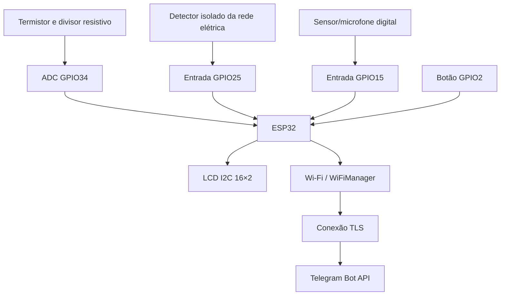

# Arquitetura

O ESP32 é o controlador central. Ele lê as entradas, calcula a temperatura, atualiza o LCD e consulta/envia mensagens pelo Telegram usando a conexão Wi-Fi.

O firmware usa `millis()`, `delay()` e flags booleanas para controlar as transições. A leitura do microfone é digital; o estado do gerador é inferido do nível detectado ao longo do tempo, não de uma análise espectral do som. O LCD e o Telegram apresentam a inferência feita pelo firmware.
